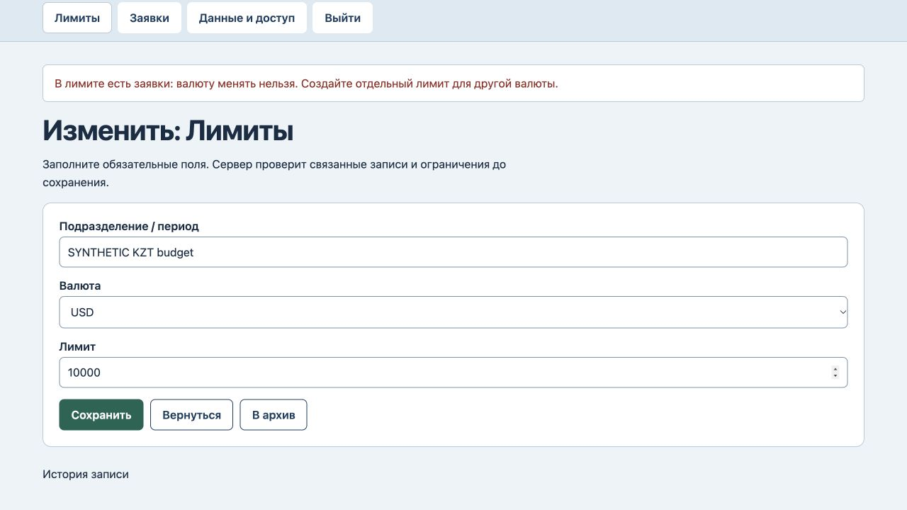
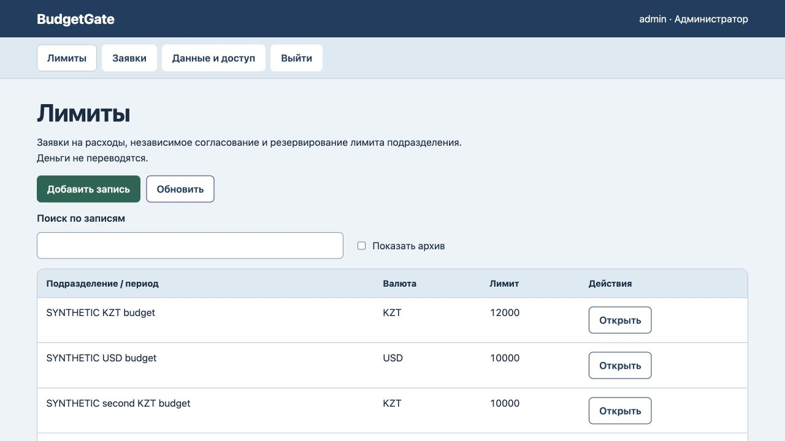

# BudgetGate: сохранение валюты заявок

24 октября 2026. Исправлены два воспроизведённых сбоя в нашей реализации: смена валюты лимита и перенос несогласованной заявки в лимит другой валюты переобозначали сумму без конвертации. На прежнем коде 7 000 KZT превращались в 7 000 USD с тем же числовым остатком 3 000. Проверены заявки в ожидании, согласованные, отмеченные как расход, отклонённые и архивные. Три новых регрессионных теста сначала завершились ошибкой.

Теперь лимит с привязанными заявками сохраняет валюту, а перенос заявки допускается только между лимитами одной валюты. Для другой валюты создаются отдельный лимит и новая заявка с явно введённой суммой. Валюта пустого лимита и сумма лимита в прежней валюте по-прежнему редактируются.

Все 7 тестов прошли, включая независимое согласование, лимит расходов, файловый перезапуск и восстановление в пустую базу. В браузере оба отказа сохранили все данные, 7 000 KZT резерва, 3 000 KZT остатка, версию 7 и 7 записей журнала. Разрешённые правки дали версию 10: перенос заявки на 1 000 KZT в другой лимит KZT, увеличение исходного лимита до 12 000 KZT и смена валюты пустого лимита на USD. После обновления страницы видны прежний резерв 7 000 KZT и новый остаток 5 000 KZT. [Машинная проверка](currency-verification.json).

Сервер проверен локально. Конвертация валют, платежи, новое размещение и клиентская приёмка не добавлены. Старые ошибочно переобозначенные записи автоматически не исправляются: для них нужна ручная сверка. Изменены предметные правила и сообщения отказа; новый полный аудит интерфейса или безопасности не проводился.
